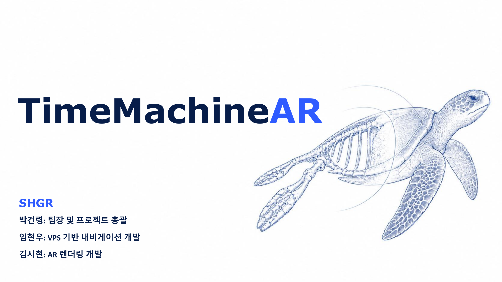
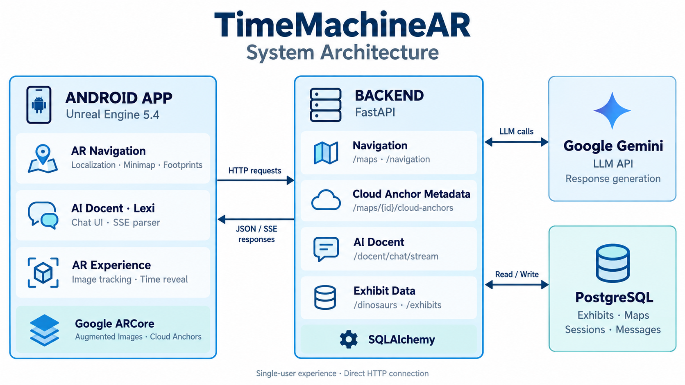

# 타임머신AR (TimeMachineAR) — 내비게이션·AI 도슨트를 탑재한 공룡 박물관 도우미 앱

> 🏆 **2026 AI·가상융합(XR) 서비스 개발자 경진대회 — 개발자 부문 (주)하이퍼클라우드 대표상 · 우수상**
> 팀 **SHGR** · [수상작 페이지](https://www.metaversedev.kr/contest-award/projects/32567238-7969-4d1a-bced-929990610f5e)


**타임머신AR**은 **내비게이션 기능과 도슨트 기능을 탑재한 공룡 박물관 도우미 앱**입니다.
스마트폰 하나로 전시관 안에서 길을 찾고, 전시물에 대한 해설을 듣고, 사라진 고생물을 AR로 만날 수 있습니다.

- **실내 AR 내비게이션**: 바닥에 찍히는 황금 발자국을 따라가면 원하는 전시물에 도착합니다.
- **AI 도슨트 '렉시(Lexi)'**: 관람객이 무엇을 물어보든 실시간으로 해설해 줍니다.
- **AR 고생물 복원**: 전시물 마커를 비추면 회중시계 '시간 여행' 연출과 함께 고생물이 실제 공간에 나타납니다.

<p align="center">
  <a href="https://www.youtube.com/watch?v=IOSgaIrnLFI">
    
  </a>
</p>
<p align="center">
  <a href="https://www.youtube.com/watch?v=IOSgaIrnLFI"><strong>▶ YouTube에서 시연 영상 보기</strong></a><br>
  <sub>실내 AR 내비게이션 · AI 도슨트 렉시 · AR 고생물 복원</sub>
</p>

---

## 목차

- [기획 배경](#기획-배경)
- [핵심 기능](#핵심-기능)
- [시스템 아키텍처](#시스템-아키텍처)
- [기술 스택](#기술-스택)
- [저장소 구조](#저장소-구조)
- [실행 방법](#실행-방법)
- [팀 SHGR](#팀-shgr)

---

## 기획 배경

공룡 박물관을 찾은 관람객은 보통 세 가지 불편을 겪습니다.

| 문제 | 타임머신AR의 해결 |
|---|---|
| 넓은 전시관에서 보고 싶은 전시물을 찾아가기 어렵다 | **실내 AR 내비게이션**: GPS 없이 바닥의 황금 발자국을 따라 전시물까지 안내 |
| 해설사의 설명은 정해진 시간과 인원에 묶여 있다 | **AI 도슨트 렉시**: LLM 기반 대화형 해설로 언제든 질문 가능 |
| 화석·골격 표본만으로는 살아 있던 모습을 떠올리기 어렵다 | **AR 복원**: 마커를 인식하면 고생물이 실제 공간에 증강되고 회중시계 '시간 여행' 연출이 재생됨 |

---

## 핵심 기능

### 1. 실내 AR 내비게이션

- **GPS 없는 실내 측위**: 마커와 ARCore Cloud Anchor로 서버의 전시관 지도를 실제 공간에 맞추고, 걷는 동안 현재 위치를 지도 좌표로 추적합니다 (`NavLocalizer`, `NavCloudResolver`).
- **서버 경로 탐색**: 서버가 전시관 그래프에서 경로를 계산하고, 관람객이 경로를 벗어나면 다시 탐색합니다 (`/navigation/route`, `/navigation/reroute`).
- **황금 발자국 길안내**: 공룡 발자국이 바닥에 좌우 번갈아 찍히며 목적지까지 이어집니다. 화면에는 남은 거리와 진행 방향이 표시됩니다 (`NavFloorGuideActor`).
- **미니맵 · 전체 지도**: 층 평면도에서 목적지를 고르고, 미니맵으로 진행 상황을 확인합니다 (`NavMinimapWidget`, `NavFullMapWidget`).
- **렉시 말풍선 안내 · 도착 시 자동 종료**: 렉시가 상황에 맞는 안내를 말풍선으로 띄웁니다. 목적지에 도착하면 안내를 마치고 AR 스캔 화면으로 돌아갑니다.

### 2. AI 도슨트 '렉시'

- **대화형 해설**: 관람객이 자유롭게 질문하면 LLM이 전시물 데이터를 바탕으로 해설을 만들어 줍니다.
- **SSE 스트리밍**: `POST /docent/chat/stream`으로 답변을 토큰 단위로 받아 타이핑하듯 출력하므로, 기다리는 시간이 짧게 느껴집니다 (`DocentClient`, `SseParser`, `DocentChatWidget`).
- **대화 세션 유지**: 세션별 대화 이력을 DB에 저장해 이어지는 질문에서도 앞의 맥락을 기억합니다.
- **빠른 질문 칩 · 폴백**: 추천 질문 칩을 제공합니다. LLM에 장애가 나면 미리 준비해 둔 해설 텍스트로 자동 전환합니다.
- **응답 속도**: 목표는 2초 이내입니다. 경량 모델과 최소 추론 설정으로 평균 약 1.5초 응답을 확인했습니다.

### 3. AR 스캔 · 고생물 복원

- **이미지 마커 트래킹**: Google ARCore로 전시물 마커를 인식하고, 공룡·고생물 3D 모델을 실제 크기로 증강합니다 (`ARTrackingManager`, `DinoOverlayActor`).
- **'시간의 문' 연출**: 마커를 인식하면 회중시계가 나타납니다. 시계를 위로 스와이프해 던지면 바늘이 돌고 Niagara 웜홀이 열리면서 아르켈론이 등장합니다 (`TimeWatchActor`, `TimeRevealComponent`).
- **종별 정보 카드**: 등장한 생물을 터치하면 서식지·크기·시대 등이 담긴 정보 카드가 열립니다. 종마다 스킨(예: 아르켈론의 바다 스킨)을 데이터로 바꿀 수 있습니다 (`DinoInfoCardWidget`, `DinoInfoData`).

---

## 시스템 아키텍처

<p align="center">
  
</p>

Unreal Engine 클라이언트가 **FastAPI 서버에 HTTP로 직접 연결**합니다. 일반 조회는 JSON으로, AI 도슨트 답변은 SSE 스트림으로 전달하며, 서버는 Gemini API와 PostgreSQL을 연동합니다.

> 초기 설계에는 다중 사용자 동기화를 위한 C++ IOCP 코어 서버(`Server_Core/`)가 있었습니다.
> 하지만 1인 관람 시나리오에는 요청-응답 구조로 충분하다고 판단해 FastAPI 서버 하나로 구성했습니다.
> 판단 근거는 [ADR-001](Documents/ADR-001-core-server-deferred.md)에 정리되어 있습니다.

### 주요 API

| 영역 | 엔드포인트 |
|---|---|
| 상태 | `GET /health` |
| 전시 | `GET /dinosaurs`, `GET /exhibits/{exhibit_id}` |
| AI 도슨트 | `POST /docent/ask`, `POST /docent/sessions`, `GET /docent/sessions/{id}/messages`, `POST /docent/chat`, `POST /docent/chat/stream` |
| 지도 | `GET /maps/{map_id}`, `/markers`, `/destinations`, `/graph` |
| 내비게이션 | `POST /navigation/route`, `POST /navigation/reroute` |
| 클라우드 앵커 | `/maps/{map_id}/cloud-anchors` (등록·바인딩·검증·에셋 보정) |

서버를 실행한 뒤 `http://localhost:8000/docs`에서 Swagger 명세를 볼 수 있습니다.

---

## 기술 스택

| 구분 | 사용 기술 |
|---|---|
| **Client** | Unreal Engine 5.4 (C++ / Blueprint), Google ARCore (Augmented Images, Cloud Anchors), UMG, Niagara, Vulkan |
| **Backend** | Python 3.10+, FastAPI, SQLAlchemy, PostgreSQL, NetworkX, Docker Compose, pytest |
| **AI** | Google Gemini API (LLM 공급자 추상화로 `gemini` / `mock` / `failing` 전환 가능) |
| **협업** | Git Flow (main / develop / feature·fix), Conventional Commits, PR 리뷰, Git LFS |

---

## 저장소 구조

```
AI-XR-Project/
├── TimeMachineAR/            # Unreal Engine 5.4 클라이언트
│   ├── Source/TimeMachineAR/ #   C++: AR 트래킹, 도슨트, 내비게이션, 시간 연출, 테스트
│   ├── Content/              #   에셋 (Git LFS)
│   └── Scripts/              #   에디터 자동화 스크립트 (에셋 임포트·검사)
├── backend_server/           # FastAPI 백엔드
│   ├── app/                  #   routers / services / models / schemas
│   ├── seeds/                #   전시·지도 시드 데이터
│   ├── tests/                #   pytest
│   └── docker-compose.yml    #   PostgreSQL
├── Server_Core/, Shared/     # C++ IOCP 코어 서버 (보류, ADR-001)
├── Documents/                # 기획·설계 문서, ADR, 런북
├── docs/                     # 기능별 구현 기록·가이드·스크린샷
└── tools/                    # 아이콘·스프라이트 등 보조 도구
```

---

## 실행 방법

> 이 저장소는 **Git LFS**를 사용합니다. 클론한 뒤 `git lfs pull`로 `.uasset`, `.png` 등 에셋을 받아야 엔진에서 정상적으로 열립니다.

### 1. 백엔드 서버

```bash
cd backend_server
cp .env.example .env              # LLM_PROVIDER, LLM_API_KEY 등 설정 (mock 모드는 키 없이 동작)
docker compose up -d              # PostgreSQL

python -m venv .venv
source .venv/bin/activate         # Windows: .venv\Scripts\activate
pip install -r requirements.txt

uvicorn app.main:app --host 0.0.0.0 --port 8000 --reload
```

자세한 절차는 [`backend_server/RUNNING.md`](backend_server/RUNNING.md)와 [`docs/server-local-setup.md`](docs/server-local-setup.md)에 있습니다.

### 2. Android 앱

1. Unreal Engine 5.4에서 `TimeMachineAR/TimeMachineAR.uproject`를 엽니다.
2. ARCore를 지원하는 Android 기기를 준비하고, `Config/DefaultGame.ini`의 `ServerBaseUrl`을 백엔드 PC의 IP로 바꿉니다.
3. `Platforms > Android > Package Project`로 `.apk`를 만들어 기기에 설치합니다.

현장 시연 절차는 [`docs/wifi-demo-runbook.md`](docs/wifi-demo-runbook.md)에 정리되어 있습니다.

---

## 팀 SHGR

| 이름 | GitHub | 역할 |
|---|---|---|
| 박건령 | [@GeonRyoung](https://github.com/GeonRyoung) | UE5 클라이언트 · AI 도슨트 UI/연동 · 내비게이션 UI · 백엔드 |
| 김시현 | [@sajul127](https://github.com/sajul127) | AR 트래킹 · 고생물 오버레이 · AR 이펙트 · 모바일 최적화 |
| 임현우 | | 실내 내비게이션 (측위 · Cloud Anchor · 경로 탐색 서버 · 길안내) |
